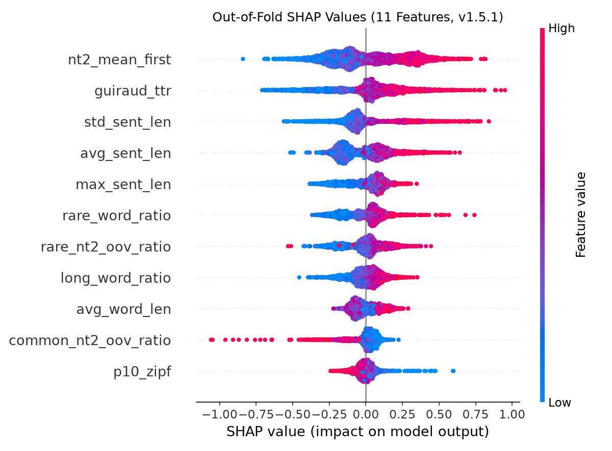

# LeesNiveau — Zero-Backend Dutch CEFR Readability Grader

**[Try the Live App](https://devimisra.github.io/leesniveau/)** · 100% client-side (no text leaves your browser)

**LeesNiveau** estimates the CEFR reading level (**A1–C2**) of Dutch text entirely in the browser using **WebAssembly (ONNX Runtime Web)** and a 128k-entry client-side lexical dictionary—no backend server, API keys, or external NLP runtime required.

## Key Features
- **100% Client-Side Inference:** Extracts 10 deterministic syntactic and lexical features in vanilla JavaScript with 4-decimal parity against Python training, then runs a 171 KB `XGBRegressor` ONNX model locally.
- **L2 Curriculum + Native Frequency Signals:** Combines **NT2Lex** textbook CEFR levels (Tack et al., 2018) with **Wiktionary** definitions (`kaikki.org`) and `wordfreq` Zipf scores.
- **Interactive Vocabulary Breakdown:** Highlights B1–C1 words, low-frequency terms, and unlisted Dutch compound words (e.g., `weekjournaal` → `week + journaal`) with English glosses.
- **Production Edge-Case Handling:** Protects common Dutch abbreviations (`o.a.`, `bijv.`, `d.w.z.`), resolves `'s` plurals and hyphenated forms, flags non-Dutch inputs, and chunks long texts (>350 words) into ~200-word sections to stay within the training length distribution.

## Modeling & Diagnostic Highlights
Evaluated via 5-fold Stratified Cross-Validation on 3,596 CEFR-graded Dutch reference texts (`local_elg_cefr_nl`):

| Model Configuration | 5-Fold QWK | Adj(±1) | Macro Recall | Out-of-Distribution Short Texts (~50w) |
| :--- | :---: | :---: | :---: | :--- |
| Baseline `XGBClassifier` (9 features, spaCy) | 0.552 | 86.4% | 41.3% | Training–serving POS skew |
| `XGBRegressor` + NT2Lex (15 features, 250 trees) | **0.618** | **92.2%** | **43.9%** | Under-predicts C1 policy as B1 (`2.38`) |
| **Production `XGBRegressor` (Pruned 10 features, 200 trees)** | **0.601** | **91.7%** | **43.2%** | **Calibrated across A2 (`1.09`), B2 (`3.36`), C1 (`3.70`)** |

- **Why Prune from 15 to 10 Features?** Out-of-fold SHAP analysis (`logs/shap_beeswarm.png`) revealed that raw `ttr` had an inverted negative slope because A1 training texts are shorter (~97 words vs. ~210 words for A2–C2), while correlated ratios (`nt2_b2plus_ratio`, `avg_zipf`) acted as fragile cancellation terms. Replacing raw `ttr` with length-corrected `guiraud_ttr` ($V / \sqrt{N}$) and pruning the 5 noisy features eliminated short-paste regressions while capping trees at 200 (matching the validation RMSE plateau in `logs/learning_curves.png`).



## Project Structure
```text
├── web/                  # Static production bundle (GitHub Pages / Cloudflare Pages)
│   ├── index.html
│   ├── style.css
│   ├── app.js
│   ├── dictionary.json   # 128,713 lemmas, inflection pointers, Zipf & NT2Lex levels
│   ├── leesniveau_model.onnx
│   └── model_meta.json
├── scripts/              # Offline dictionary build, benchmarking, SHAP analysis & ONNX export
├── tests/                # Pytest integrity, homograph & ONNX inference parity checks
└── logs/                 # 5-fold CV learning curves, confusion matrix, SHAP plots & error audit

## License & Data Attributions

- **Source Code (`scripts/`, `tests/`, `web/*.html`, `web/*.css`, `web/*.js`):** Released under the [MIT License](LICENSE).
- **Compiled Data & Model Artifacts (`web/dictionary.json`, `web/leesniveau_model.onnx`):** Distributed for **non-commercial use only**, subject to the respective licenses of the upstream datasets below. Raw training and lexicon files are not redistributed in this repository.

### Third-Party Datasets
- **NT2Lex (Lexical CEFR Levels):** Tack, A., François, T., Desmet, P., & Fairon, C. (2018). *NT2Lex: A CEFR-Graded Lexical Resource for Dutch as a Foreign Language Linked to Open Dutch WordNet.* BEA 2018. Available via [CENTAL / UCLouvain](https://cental.uclouvain.be/cefrlex/nt2lex/) under **CC BY-NC-SA 4.0**.
- **Wiktionary via kaikki.org (Definitions & Inflections):** Derived from English Wiktionary contributors via [kaikki.org](https://kaikki.org/) (`wiktextract`, Ylonen, 2022) under **CC BY-SA 4.0** / **GFDL**.
- **wordfreq (Zipf Word Frequencies):** Speer, R. (2022). *rspeer/wordfreq*. Code licensed under **Apache 2.0**; frequency data redistributed under **CC BY-SA 4.0**. Credits include the **SUBTLEX** authors (SUBTLEX is freely available data).
- **ELG Dutch CEFR Dataset (Model Training Corpus):** Sourced from EDIA / European Language Grid via [UniversalCEFR/elg_cefr_nl](https://huggingface.co/datasets/UniversalCEFR/elg_cefr_nl) under **CC BY-NC 4.0** (non-commercial, academic/research use).